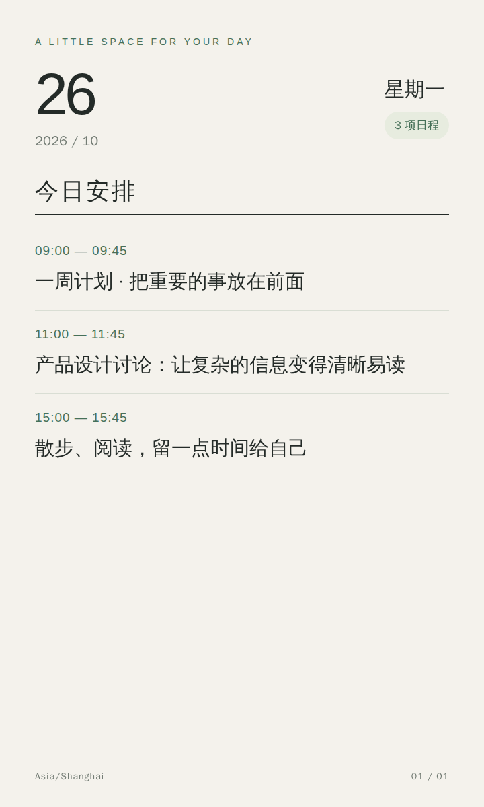
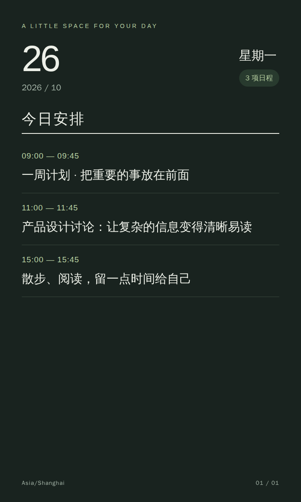

# DayLeaf 🍃

一个供 **Hermes Agent** 使用的轻量级日程管理 Skill。通过微信、QQ 等聊天渠道说出安排，由 Agent 理解自然语言、调用本地 Python 脚本管理日程，并生成适合手机阅读的每日卡片。

**本地 JSON · Python 标准库 · HTML/CSS 卡片 · 复用 Hermes 推送**

## 卡片预览

以下图片使用虚构示例日程，展示浅色和深色主题。

| 浅色 | 深色 |
| --- | --- |
|  |  |

720 × 1200 竖屏卡片包含日期、星期、当天日程数量与起止时间。中文标题自动换行；日程过多时按实际排版高度分页，超长单项跨页延续，避免缩小字体或截断内容。

## 功能

- 添加、查询、修改、删除日程；唯一 ID、标题、开始时间、可选结束时间和备注。
- JSON stdin/stdout CLI，适合 Agent 直接调用。
- 今日、本周纯文本摘要；默认 `Asia/Shanghai`，支持 IANA 时区。
- 冲突默认拒绝保存；用户明确接受后才允许重叠。
- 修改、删除必须使用完整 ID；目标不明确时 Agent 先向用户澄清。
- 本地文件锁、临时文件、`fsync` 与原子替换，避免并发写入丢失。
- 每日先发送文本摘要，再发送图片；图片失败时已送达的文本仍可阅读。

不包含 Web 管理端、数据库、账户系统、循环事件或逐项提醒服务。同一 Hermes profile 下的渠道共用一份个人日程。

## 环境要求

- Linux 或 macOS，Python **3.9+**，系统 IANA 时区数据。
- 已安装并配置消息渠道的 Hermes Agent，支持 `hermes send`。
- 生成图片需要已安装的 Chrome/Chromium 和中文字体（例如 Noto Sans CJK 或文泉驿正黑）。仅管理日程或发送纯文本不需要浏览器。
- 微信、QQ 等插件平台可能依赖运行中的 Hermes gateway、有效会话及平台发送权限。

Python 代码仅使用标准库，不需要 `pip install`。使用 POSIX `fcntl` 文件锁，不直接支持原生 Windows。

## 安装

```bash
git clone https://github.com/Seagull-W/DayLeaf-skill.git \
  "${HERMES_HOME:-$HOME/.hermes}/skills/productivity/DayLeaf"
```

在 Hermes 新会话中使用 DayLeaf；如果当前会话尚未发现 Skill，刷新 Skill 列表或启动新会话。Agent 的操作规范见 [SKILL.md](SKILL.md)。

默认数据存放于 `${HERMES_HOME:-~/.hermes}/agenda/events.json`，独立于 Skill 仓库。可通过 `--data` 指定其他文件。多 profile 部署时，应让脚本数据路径和 Hermes 发送进程使用同一 `HERMES_HOME`。

## CLI 使用

```bash
SKILL_DIR="${HERMES_HOME:-$HOME/.hermes}/skills/productivity/DayLeaf"

python3 "$SKILL_DIR/scripts/agenda.py" <<'JSON'
{"action":"add","title":"项目讨论","start":"2027-01-18T09:00:00+08:00","end":"2027-01-18T10:00:00+08:00","notes":"带上草稿"}
JSON

python3 "$SKILL_DIR/scripts/agenda.py" <<'JSON'
{"action":"summary","period":"today","timezone":"Asia/Shanghai"}
JSON
```

每次调用读入一个 JSON 对象，返回一个 JSON 对象。更多请求示例：

```json
{"action":"list","query":"项目"}
{"action":"list","period":"week"}
{"action":"update","id":"完整日程ID","changes":{"title":"方案讨论"}}
{"action":"delete","id":"完整日程ID"}
```

成功返回 `ok:true`，退出码 0；校验、冲突或读写失败返回 `ok:false`，退出码 1。CLI 参数错误退出码 2。遇到冲突，数据尚未保存；明确接受后，在添加或修改请求中加入 `"allow_conflict":true` 重试。

时间必须带明确 UTC 偏移，例如 `2027-01-18T09:00:00+08:00`。自然语言由 Agent 解释，脚本不猜测“晚点”“下午左右”等模糊时间。结束时间未知时省略，不默认一小时。无结束时间的日程按时间点检测冲突。

## 卡片与推送

```bash
# 只生成预览，不发送消息
python3 "$SKILL_DIR/scripts/daily_summary.py" --dry-run --theme light
python3 "$SKILL_DIR/scripts/daily_summary.py" --dry-run --theme dark

# 查看当前 Hermes 可用目标（输出可能含私人聊天 ID，请勿公开）
hermes send --list --json

# 替换为你自己的目标，再执行真实推送
python3 "$SKILL_DIR/scripts/daily_summary.py" \
  --to 'PLATFORM:CHAT_ID' --theme light
```

- `--chrome /path/to/chrome`：指定浏览器；默认自动寻找 Chrome/Chromium。
- `--hermes /path/to/hermes`：指定 Hermes CLI；定时任务建议使用绝对路径。
- `--output-dir /path/to/cards`：指定卡片目录；默认是数据文件旁的 `cards/YYYY-MM-DD/`。
- `--timezone Asia/Shanghai`：控制当天范围和显示时区。
- `--text-only`：跳过图片渲染，仅发送文本；可与 `--dry-run` 合用。

推送复用 `hermes send --to ... --file - --json` 和 `MEDIA:/绝对路径.png`，没有独立消息服务。卡片不显示备注，文本摘要保留备注。文本、图片使用同一次日程快照。

图片失败时返回 `ok:false`、`error:image_failed` 和非零退出码。`sent:true` 表示文本已送达；`image_sent:true` 表示图片全部送达。不要自动重试整次调用，以免产生重复消息。图片和文本仍受平台会话、大小及发送频率限制。

## 每日自动发送

Linux 可用已有 cron，每天运行同一个入口。先确认以下信息：

```bash
command -v python3 hermes google-chrome
# 检查主机时区；cron 的 08:00 使用主机调度时区
date '+%Z %z'
crontab -e
```

下面是**模板**，须替换所有 `/ABS/PATH/` 路径和 `PLATFORM:CHAT_ID`：

```cron
0 8 * * * HERMES_HOME=/ABS/PATH/.hermes PATH=/usr/local/bin:/usr/bin:/bin /usr/bin/flock -n /ABS/PATH/dayleaf.lock /usr/bin/python3 /ABS/PATH/DayLeaf/scripts/daily_summary.py --timezone Asia/Shanghai --theme light --hermes /ABS/PATH/hermes --chrome /ABS/PATH/chrome --to 'PLATFORM:CHAT_ID' >> /ABS/PATH/dayleaf.log 2>&1
```

`--timezone` 只控制摘要日期，不会修改 cron 的触发时区。目标目录需要可写。macOS 默认没有 `flock`，可使用本机调度机制调用脚本。

也可将相同命令放入 systemd oneshot service，并使用 `OnCalendar=*-*-* 08:00:00 Asia/Shanghai` 的 timer。两种调度方式只选一种；默认不自动重试或补发。脚本本身不做跨次调用去重。

## 测试

```bash
python3 -m unittest discover -s tests -v

# 可选：真实 Chrome 分页与 PNG 检查（该测试当前使用 google-chrome）
AGENDA_RENDER_TEST=1 python3 -m unittest discover -s tests -v
```

测试使用临时目录和模拟发送，不触碰真实日程，不向渠道发送消息。真实浏览器测试覆盖分页、超长中文/英文标题、文字完整性和图片尺寸。

## 项目结构

```text
SKILL.md                  Agent 调用和对话规则
scripts/agenda.py         本地存储、校验、CRUD 与文本摘要
scripts/daily_summary.py  每日文本/图片推送入口
scripts/render_card.py    本地 Chrome 渲染
templates/card.html      卡片 HTML/CSS 模板
tests/                   标准库 unittest 测试
previews/                虚构示例日程的主题预览
```

## 隐私与维护

仓库不包含真实日程、聊天 ID、渠道凭据、个人机器路径或发送日志；预览图片使用虚构数据。`.gitignore` 排除常见运行数据与本地配置。

配置和日志留在本机；不要提交 `.env`、Hermes 配置、渠道目录、实际 cron 配置或生成的真实卡片。HTML 和 PNG 同样包含日程内容，应按个人数据管理。默认卡片目录不自动清理，可按需删除旧日期产物。

写入保护依赖本地文件系统及所有写入者遵守同一文件锁，不建议将数据文件放在网络文件系统。JSON 损坏时会拒绝覆盖，请先保留文件并从备份恢复。
